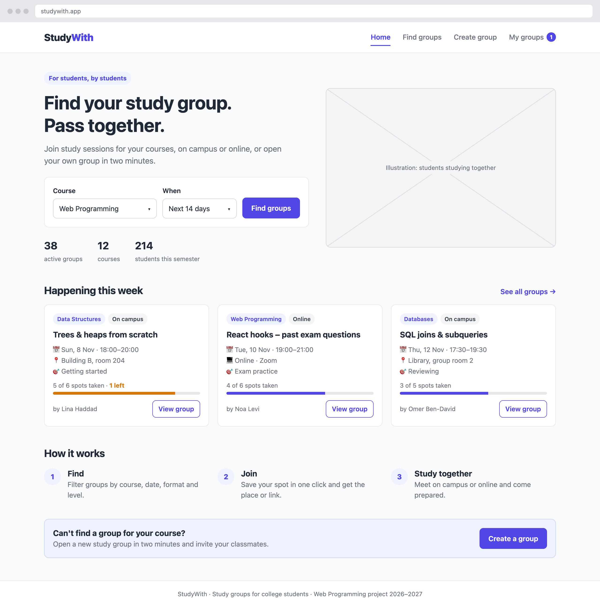

# StudyWith

**Find your study group. Pass together.**

StudyWith is a web app where college students find, join and create study groups for their courses, on campus or online. It's our semester project for **Web Programming (Client Side)**, School of Information Systems, 2026–2027.



## Team

| Name | GitHub |
|------|--------|
| Abed Abuata | [Abedab2](https://github.com/Abedab2) |
| [Teammate 2] | [username] |
| [Teammate 3] | [username] |

## Exercise 1 – Project approval

- **Submission document:** [docs/Exercise1-Project-Approval.docx](docs/Exercise1-Project-Approval.docx), with the system description, persona, scenarios, user flows and wireframes
- **Wireframes:** [docs/wireframes](docs/wireframes), five screens for desktop and mobile
- **User flows:** [docs/user-flow](docs/user-flow), one diagram per scenario

### The five screens

| # | Screen | Purpose |
|---|--------|---------|
| 1 | Home | Quick search by course, this week's groups, call to create a group |
| 2 | Find Groups | Filter and browse all study groups |
| 3 | Group Details | Agenda, time, place and free spots; join with one click |
| 4 | Create Group | The main form (14 fields with validation), saved through the course API |
| 5 | My Groups | Sessions you joined and groups you created |

## Project structure

```
web-project/
├── docs/
│   ├── Exercise1-Project-Approval.docx   Exercise 1 submission
│   ├── wireframes/                       Wireframe images (desktop + mobile)
│   │   └── source/                       HTML/CSS used to draw the wireframes
│   └── user-flow/                        User flow diagrams (SVG + PNG)
└── README.md
```

The React app (React + Tailwind CSS) will be added to this repository after Exercise 1.

## Milestones

- [ ] **Exercise 1 – Project approval:** system description, persona, two scenarios, user flows and wireframes for all five screens
- [ ] **React implementation:** five screens, the Create Group form saved through the course API, filterable group list, responsive layout
- [ ] **Final submission**

## Working together

1. **Before you start:** click **Sync Changes** in VS Code's Source Control view to get your teammates' latest work.
2. **After a change:** write a short commit message (for example "Update persona"), then click **Commit**.
3. **Upload:** click **Sync Changes** again.
4. **Avoid conflicts:** don't edit the same file as a teammate at the same time. Word files can't be merged, so only one person should edit the `.docx` at a time.
